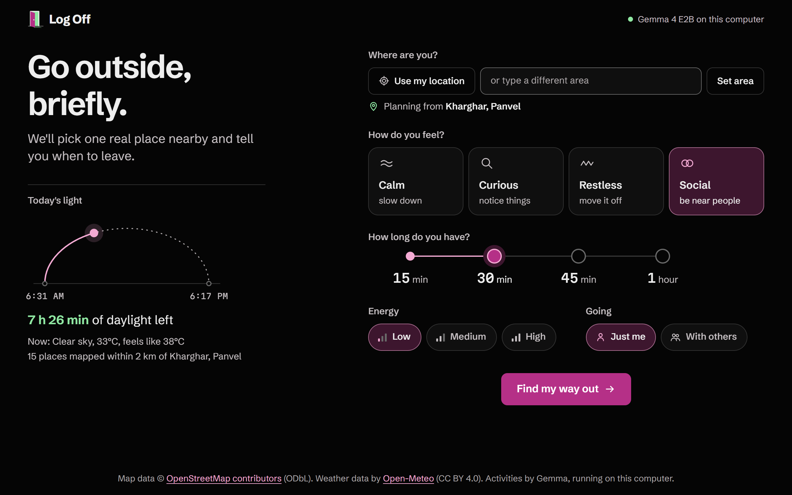
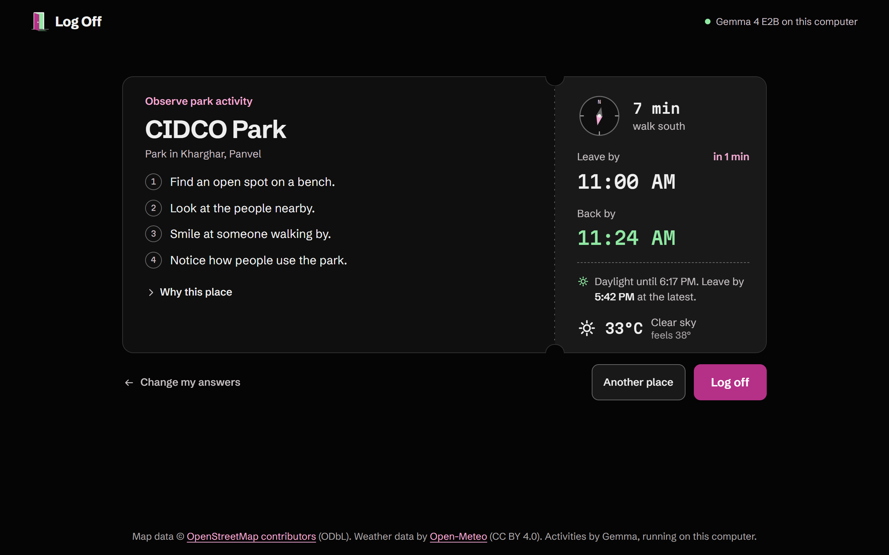

#  Log Off

Log Off turns a few preferences into one short reason to leave the screen. Pick a mood, the time
available, your energy, and whether you are alone. The app finds a real nearby place, works out a
safe walking window around daylight and weather, and asks a local Gemma 4 model for one small
activity to do there.

The result is a single outing ticket with where to go, when to leave, when to be back, and a task
that needs no phone, purchase, or equipment.

Built for the [DEV Hacktoberfest Open-Source AI Challenge, Week 1: Touch
Grass](https://dev.to/challenges/hacktoberfest-week1-2026-10-05).

## Screenshots

<p align="center">
  
  
</p>

## How it works

Log Off keeps facts and generation separate:

1. **Find facts.** A typed area or browser location is rounded to three decimal places before the
   app requests nearby places from OpenStreetMap and daylight and weather data from Open-Meteo.
2. **Build a shortlist.** Python code calculates walking time and direction, removes places that do
   not fit the selected time, and decides whether the outing should happen now or after sunrise.
3. **Ask local Gemma.** Gemma 4 E2B runs through Ollama on the user's computer. It sees
   preferences, weather, and numbered candidate places, but never coordinates. It selects one ID
   and writes a short activity as structured JSON.
4. **Validate the answer.** Code checks the schema, place ID, duration, invented place names,
   unsafe suggestions, and forbidden distances or clock times. A rejected answer gets one retry;
   if that also fails, a deterministic built-in activity keeps the app usable.
5. **Render trusted facts.** Distances, times, daylight guidance, and the explanation shown under
   "Why this place" come from code, not from model claims.

The app is a TypeScript/Vite frontend served by a FastAPI backend. Place and weather responses are
cached locally for 24 hours. If Ollama is unavailable, the same real-place pipeline still produces
a ticket with a built-in activity.

## Run locally

### Prerequisites

- Python 3.12 or newer
- [uv](https://docs.astral.sh/uv/)
- Node.js and npm
- [Ollama](https://ollama.com/)

Clone the project and pull the model:

```powershell
git clone https://github.com/rahultapase/log-off.git
Set-Location log-off
ollama pull gemma4:e2b
```

Make sure Ollama is running, then install the pinned Python dependencies:

```powershell
uv sync
```

Build the frontend:

```powershell
Set-Location frontend
npm ci
npm run build
Set-Location ..
```

Start the local server:

```powershell
uv run uvicorn logoff.main:app --app-dir backend --host 127.0.0.1 --port 8000
```

Open <http://127.0.0.1:8000>. On first use, Gemma can take 18 to 20 seconds to load; later model
calls are much faster while Ollama keeps it warm.

To run the existing checks:

```powershell
uv run pytest
Set-Location frontend
npm run build
```

## Evaluation

The main evaluation used 24 combinations of mood, 30/45/60-minute budgets, company, and varied
energy at 4:00 PM in Kharghar. Every answer went through the same planner and validator used by the
app.

| Result with `gemma4:e2b` | Measured value |
| --- | ---: |
| Valid on the first attempt | 23 of 24 |
| Fixed on the single retry | 1 of 24 |
| Deterministic fallback used | 0 of 24 |
| Invented-place runs | 0 of 24 |
| Median model-call latency | 2.8 seconds |
| Maximum model-call latency | 3.2 seconds |

A separate 12-run after-dark pass was valid on the first attempt every time, with no invented
places or fallbacks. Swapping in `gemma3:1b` made the guardrail's value clearer: none of 12 answers
passed first try, 11 were repaired on retry, and one used the fallback.

The validator is intentionally not a judge of taste. One factual, schema-valid Gemma 4 answer for
social, with others, and low energy was "Start a simple card game like Uno." That needs equipment
even though the prompt said otherwise. This remains an honest limitation and a useful next
validator rule. The weather sentence also describes current conditions even when an after-dark
plan is moved to tomorrow morning.

## Privacy and security

- The server binds to `127.0.0.1` and has no authentication because it is designed as a
  single-user laptop app. Do not expose it to a network without adding authentication and other
  production controls.
- Gemma runs locally through Ollama. It receives candidate labels and preferences, never latitude
  or longitude.
- Coordinates sent to OpenStreetMap and Open-Meteo are rounded to three decimal places, roughly
  100 metres. Typed area searches are sent to OpenStreetMap's geocoder.
- Place and weather lookups require internet access. Model inference does not.
- No API keys or connection strings are required.

## Data, model, and licences

- Place and geocoding data: [OpenStreetMap contributors](https://www.openstreetmap.org/copyright),
  available under the Open Data Commons Open Database License (ODbL).
- Weather and daylight data: [Open-Meteo](https://open-meteo.com/en/license), available under
  Creative Commons Attribution 4.0 International (CC BY 4.0). Log Off selects and reformats the
  returned values; Open-Meteo does not endorse this project.
- Model: [Gemma 4](https://opensource.googleblog.com/2026/03/gemma-4-expanding-the-gemmaverse-with-apache-20.html),
  released under the [Apache License 2.0](https://www.apache.org/licenses/LICENSE-2.0), run locally
  through Ollama.
- Application source code: [MIT](LICENSE).

## Commits after the deadline

None. If any fixes are committed after the challenge deadline, their links and purpose will be
listed here.
